# Agent Harness Platform

**现有 OpenCode PDLC 平台的下一代执行架构：保留已建能力、支持无感迁移，新增可组合的专业 Agent 与任务串联。** Coding 能力继续复用 OpenCode，平台层不再与单一 Agent SDK 绑定。

> **项目阶段：正式研发实施（Implementation），非 POC 阶段，生产准入仍为 NO-GO。** 状态核对截至 **2026-10-11**。DEV-M0 架构决策已冻结、DEV-M1/M2 开发切片已交付：Docker PostgreSQL/真实 Hatchet、双 SDK、LiteLLM Responses、模型文本 SSE/PG 游标回放与模型级取消已通过实际联调及 CI；**完整 Run/Plan/Replan、ACK 丢失与非幂等 Receipt、Cube 可信接管、审批、PDLC 迁移和上线 Gate 仍待正式研发验收**。当前 Process/Durable SPI 实施基线为 Hatchet + PostgreSQL，DBOS 已按许可证结论排除。
> **阅读说明：** 本 README 是项目的**总体方案与项目入口**。正式语义遵循已 Accepted 的 [Architecture Contracts](docs/references/README.md)；正在比较的技术方案、具体实现、历史实验和风险以所链接的专题及 [Backlog](docs/ARCHITECTURE_BACKLOG.md) 为准。本文不将候选方案擅自升级为正式 ADR。

> **当前架构选型与分层图权威增量：** [Hatchet Process/Durable 架构与职责/恢复/部署边界](docs/references/HATCHET_PROCESS_DURABLE_ARCHITECTURE_20261010.md)（候选实施基线，非生产 Accepted ADR）。**Control Plane 自研边界已按 [ADR-031：薄应用/领域控制层](docs/references/THIN_HARNESS_CONTROL_PLANE_DECISION_20261010.md) 收敛**：Hatchet 是技术执行状态/队列/调度权威；Harness 保留必要 Run/Step/Attempt 业务事实、Approval/Receipt/授权/业务终态和状态投影，不再造第二套技术执行状态机。

> **架构阶段最终三合同（ADR-032 / ARCH-TODO-030：DECIDED）**：[HC-01 Workflow Mapping / Replan](docs/references/HATCHET_WORKFLOW_MAPPING_CONTRACT_20261010.md) · [HC-02 Outbox / 状态投影 / 非幂等 Receipt 一致性](docs/references/HARNESS_HATCHET_CONSISTENCY_CONTRACT_20261010.md) · [HC-03 Worker / ExecutionContext / Cube 可信绑定](docs/references/HATCHET_WORKER_SANDBOX_BINDING_CONTRACT_20261010.md)。**这三份冻结接口与安全语义，非真实集成验收 PASS。**第 4 项旧 PDLC API/会话/数据盘点已转 [Development Backlog](docs/DEVELOPMENT_BACKLOG.md) 中的 DEV-PDLC-01～05，不阻碍架构阶段收口。

> **正式研发里程碑计划（项目管理主入口）**：[DEV-M0～M9 计划、依赖/并行顺序、退出门禁及 PDLC-M0～M4](docs/DEVELOPMENT_MILESTONES.md)。**OpenSpec 分阶段实施**：DEV-M3～M9 的 Proposal / Specs / Design / Tasks 已分别建档，规划校验通过，代码实现进度不由文档 4/4 推断；详见计划 §4。原 [minimal-run-closed-loop](openspec/changes/minimal-run-closed-loop/) 为历史已验收开发切片，原始代码与 [Compose](compose.yaml) 继续保留。

> **M1 真实模型业务 Agent（LIMITED LIVE PASS）**：[OpenSpec 需求和任务](openspec/changes/archive/2026-10-11-real-model-agent-closed-loop/) · [真实模型与 Run Inspector 使用方法](poc/closed_loop/README.md#m1-real-litellm-responses-model-explicit-opt-in) · [测试与失败复盘](docs/retrospectives/REAL_MODEL_AGENT_CLOSED_LOOP_20261011.md)。Pydantic AI → OpenAI Agents SDK 已通过真实 LiteLLM Responses + PG 端到端，**真实模型文本 Token SSE、PG 游标重放与模型-only 取消已 LIMITED LIVE PASS；Cube、Tool Receipt、审批与生产仍 NO-GO**。

> **POC 实测与复盘：** [最小闭环 POC README](poc/closed_loop/README.md) · [测试先行/故障复盘](docs/retrospectives/MINIMAL_CLOSED_LOOP_20261010.md) · [真实闭环 CI](https://github.com/Bulls1986/Agent-Harness-Platform/actions/runs/38037718378)。
>
> **开发架构护栏：** [G01–G20 架构原则、硬约束和 PR/CI 准入](docs/ARCHITECTURE_GUARDRAILS.md)。开发前从 AGENTS.md 进入；违反 Accepted Contract 必须先经过 ADR，候选选型不得因局部 POC PASS 自动升格。

## 1. 一分钟读懂：为什么做、做什么、现在到哪一步

### 当前建设现状：从一个 Coding Agent 扩展到了多种业务场景

企业内部已建设基于 **OpenCode** 的 PDLC 平台，产品、研发、测试、文档及业务等 Agent **目前统一使用 OpenCode 实现**。这一选择有充分的起步价值：OpenCode 本身是 Coding Agent，在代码阅读、文件修改、Shell、Git、代码执行和研发工具集成方面有成熟能力，帮助现有 PDLC 快速形成可用的 Agent 体验。

但随着应用范围从研发编码扩展到需求分析、结构化文档处理、业务决策、系统协作和审批流程，**OpenCode 以 Coding 为中心的设计逐渐显现适配成本**：一些非 Coding Agent 并不需要完整的文件/Shell 执行环境，却要围绕 OpenCode 的交互和执行模型做额外补充；要实现跨 Agent 编排、持久任务状态及统一治理，还需要持续增强平台外围能力。这不是否定 OpenCode 的编码优势，而是说明**单一 Coding Agent 不适合承担所有业务 Agent 的平台底座职责**。

与此同时，不同 Agent SDK 各有适用领域，合理组合可能比强制统一获得更好的效果：

| Agent 技术 | 相对擅长的方向 | 在新平台中的定位 |
|---|---|---|
| **OpenCode 2** | 代码库分析与修改、Shell/Git、Coding Skills 和研发工具链 | **继续保留**，作为现有 PDLC 的 Coding Runtime |
| **Pydantic AI** | 类型化输入/输出、结构化数据校验、轻量业务 Agent 与工具调用 | 通用业务、文档抽取、规则化结果处理的候选 Runtime |
| **OpenAI Agents SDK** | 工具调用、Agent Handoff、轻量多 Agent 协作与公开扩展接口 | 通用及协作类 Agent 的可选 Runtime |
| **Microsoft Agent Framework（MAF）** | 显式 Workflow/Executor、复杂流程控制与既有 Microsoft 集成 | 工作流型 Agent 和已有系统接入的可选 Runtime |

这里的“擅长”指**SDK 的设计侧重点与可复用能力**，不是已经证明某个 SDK 在所有对应业务的效果都优于其他 SDK；最终效果还取决于模型、Prompt、工具和具体业务验收。相关技术选型与 POC 见[候选技术对比](docs/references/MULTI_HARNESS_TECH_SELECTION_20261009.md)。

### 由此产生的核心问题

1. **单一底座与业务场景不匹配：** 使用 OpenCode 实现所有 Agent，使非编码场景需要越来越多的定制和补丁，长期演进成本上升。
2. **难以发挥专业 SDK 的优势：** Agent 与 OpenCode 的运行模型绑定过深，即使另一套 SDK 更适合某种业务，也难以低成本接入、替换和升级。
3. **缺少平台级任务串联：** 多个 Agent 不只是互相调用一下工具，还需要明确的任务步骤、输入输出交接、验证、审批、失败处理和恢复；这些不能只靠 Prompt/Skill 隐式约定。
4. **执行资源与任务状态耦合：** 轻量业务 Agent 与需要 Shell/Git 的 Coding Agent 采用同样重的执行环境不经济；简单共享宿主机又难以实现工作空间和权限隔离。
5. **已有建设不能丢：** 现有 PDLC 的界面、项目、Agent/Skill/MCP 配置、用户会话和业务资产必须平滑保留。新技术架构如果要求用户重新建立这些内容，就没有达到平台替换的业务目标。

### 我们的答案

**以兼容现有 PDLC 为前提，将平台执行控制从 OpenCode 中解耦：保留其擅长的 Coding 能力，允许不同 Agent 选择合适的 SDK，并由统一 Harness 负责任务串联、状态、恢复和隔离。**

可以把它理解为一套**任务调度台 + 执行记录簿 + 安全工作间租用系统**：

- **调度台（Harness Control Plane）**：记录任务、决定执行顺序、权限、验收、失败处理和恢复。
- **专业执行者（Agent Runtime Adapter）**：使用 Pydantic、OpenAI、OpenCode、MAF 各自擅长的能力做事。
- **工作间（SandboxProvider）**：需要读写文件、运行命令、Git 或编译时才申请 Cube Sandbox；不需要时不占用沙箱。
- **记录簿（PostgreSQL + 对象存储引用）**：保留任务事实、版本、产物与证据；不以某个 SDK 的 Session/Checkpoint 充当唯一任务状态。

**最终目标：** 平台可通过配置 Recipe **串联不同类型的 Agent，形成可验证、可暂停和可恢复的任务**；普通会话共享 Worker，重资源阶段才按需占用隔离沙箱，各 Agent 仅在授权范围内交接工作空间与证据。

**第一期交付原则：存量 PDLC 功能、资产与用户体验不退化，同时提供平台级跨 Agent 串联。** 这是两项独立验收要求，不能仅凭 SDK/Cube 技术 POC 通过就宣布已完成迁移。详见[现有 PDLC 替换与无感迁移设计](docs/references/PDLC_REPLACEMENT_MIGRATION_20261010.md)。

### 当前实际结论

| 判断 | 结论 |
|---|---|
| Cube 真正能提供隔离 MicroVM 与文件/Shell 吗？ | **真实 POC 通过** |
| 一个 Cube 内能运行 OpenCode 2，并创建两个逻辑 V2 Session 吗？ | **真实 POC 通过** |
| Git、文件、Shell 与 Pydantic/OpenAI Tool 能接力吗？ | **真实 POC 通过**；同一 Sandbox、零托管模型调用 |
| 官方 E2B SDK 可直接连接自建 Cube 吗？ | **限定版本通过**：E2B 2.40.0 + 指定 DNS/TLS；2.53.1 创建请求仍 HTTP 405 |
| 两个 Agent SDK 能在统一平台 Run Contract 下运行吗？ | **开发切片 LIVE PASS**：Pydantic AI/OpenAI Agents SDK 真实 LiteLLM Responses、Hatchet DAG + 独立 PG、持久业务结果与 Inspector；不代表 M3～M6 全功能 |
| Hatchet 多 Engine / PostgreSQL 下 Worker A 强杀、B 接手原 Workflow 吗？ | **真实限定 PASS**：安全步骤、A 不重启、已完成步骤不重复；尚未验证平台同 Run + Cube + 非幂等 Tool 全链 |
| 统一 Agent 运行、真实模型 Token SSE、Tool Receipt、租约接管是否端到端完成？ | **模型-only 真实 Token SSE + PG 游标/取消已开发验收；非幂等 Tool Receipt、Cube 真实租约接管及审批未完成** |
| 可以进入集成开发吗？ | **已经进入正式开发阶段；下一步 DEV-M3/M5 与 PDLC-M0 并行推进** |
| 可以宣布企业生产上线了吗？ | **不可以（NO-GO）** |

## 2. 这套平台具体怎样工作？

以**研发任务**为例：

> “请分析一个缺陷，修改项目代码，运行测试，生成变更说明，审核后提交。”

| 阶段 | 谁负责 | 平台保留什么 |
|---|---|---|
| 接到用户请求 | 门户 / API / Agent Router | Conversation、Turn、Run、发起人和目标 |
| 制定计划 | Planner / 专业 Agent | 有版本的 Plan、Step、验收标准 |
| 选择执行者 | AgentRuntime SPI | Pydantic / OpenAI / OpenCode 等 Runtime 绑定版本 |
| 分配可执行环境 | SandboxProvider + 外部 Cube | 授权 Scope、Lease、Sandbox ID、WorkspaceRef |
| 读取代码、修改、运行测试 | OpenCode 或其他 Agent，经 Cube 执行 | Attempt、Execution、Tool 调用与实际 Evidence |
| 判断是否完成 | Verifier + Harness 状态机 | Verification、Artifact、失败原因、下一次 Attempt/Replan |
| 审批、暂停或重试 | Harness + Process/Durable SPI（Hatchet Adapter）/ 外部审批输入 | Approval、RecoveryPoint、版本、执行结果及可能的 UNKNOWN 副作用 |
| 返回用户 | Responses-compatible API + SSE | 真实 Text/Activity/Tool/Artifact 事件与可回放序号 |

**一个直观例子：** 产品 Agent 产生需求说明后，研发 Agent 可以在同一**已授权**项目 Workspace 内修改代码，测试 Agent 从相同 Workspace 获取结果继续验证。平台记录“哪一次尝试修改了什么、验证依据是什么”，而不要求三个 Agent 共用一个进程或同一个框架。

### 平台核心业务能力：跨 Agent 串联

**业务目标已经明确：在无感替换现有 PDLC 的同时，让不同专业 Agent 能按步骤串起来完成一项任务。** 首个真实验收应选择现有 PDLC 的需求分析 Agent → 代码实现 Agent → 验证 Agent；同样的机制也能支持文档抽取 → 数据核对 → 业务提交。**PDLC 是优先迁移与验收场景，但串联机制不能写死为 PDLC 专用流程。**

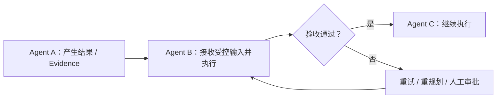

由平台的 **Recipe / Plan / Step** 表达执行依赖及每步的 Runtime 选择；跨 Agent 传递**结构化输出、Artifact/Evidence 引用、必要上下文和受控 WorkspaceRef**，而不是强制共享同一 SDK、OS 进程、完整聊天历史或直接交出 Sandbox ID。交接前需检查输入契约、Scope、权限及冻结版本。

**第一期优先级：** 顺序串联 → 可靠结果交接 → 验收失败阻断/重试 → 审批暂停和任务级恢复。条件分支与独立步骤并行可依同一依赖模型演进；深度递归子 Agent、A2A、完整 BPMN 引擎不作为第一期前提。

**证据边界：** 真实 Cube 上不同 SDK 的 Tool 已能读取同一授权 Workspace；**一个 Run 内由 Harness 按 Recipe 调度 A→B、保存交接事实并完成验收/失败恢复的端到端业务串联尚未实测**，应作为下一阶段 P0 门禁。

> **实施状态提示：** 上表是目标端到端流程，不是声称所有阶段都已被一个统一服务串联。仓库目前包含若干真实专项 POC 和一个最小 Runtime SPI 原型；完整一体化 API/任务执行服务仍属于集成阶段。

## 3. 总体架构：控制平面和执行平面分开

**阅读说明：** 下方在总体架构图和核心组件说明之后，直接展示业务、逻辑、应用、技术、数据、部署、功能与运行架构图（9 张 Mermaid 图）。这些是职责与候选方案的视图，不改变既有 Accepted Contract，也不代表生产能力全部验收。

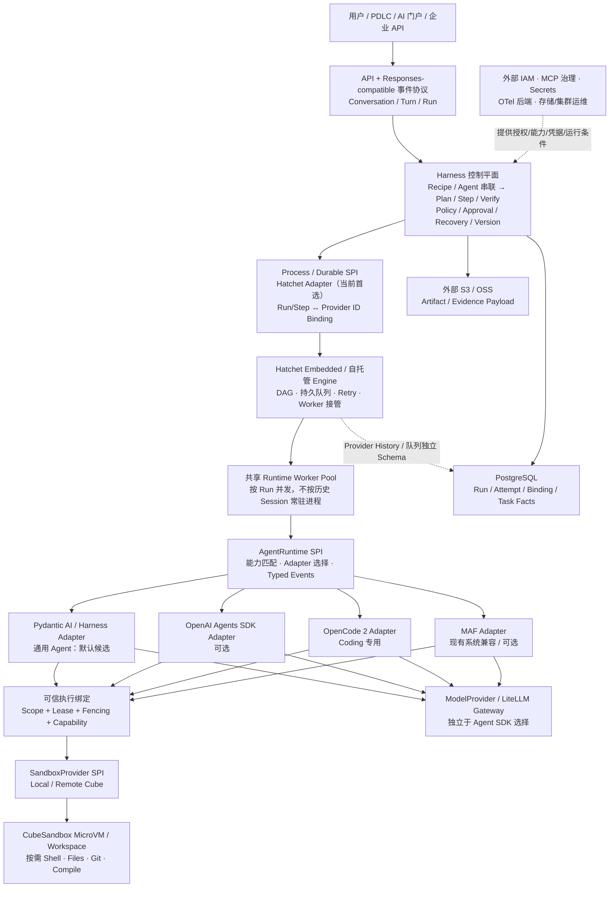

**读图时记住三个“不等于”：**

- **AgentRuntime 不等于 Process/Durable：** Pydantic/OpenCode 负责 Agent 怎么运行；Hatchet 负责持久 DAG、任务队列、重试与 Engine 层 Worker 接管，平台负责 Run/Step/Attempt、审批、Receipt 与恢复裁决。
- **逻辑 Session 不等于 OS 进程，也不等于 Sandbox：** 可以让许多逻辑 Session 由共享 Worker 服务；只有需要实际命令/文件隔离时才拿 Sandbox Lease。
- **Cube 不等于 Harness Control Plane：** Cube 负责启动和销毁 MicroVM，平台负责为什么执行、是否有权限、失败是否允许重试。

### 核心组件及负责范围

| 层 | 平台**拥有**的能力 | 不重复建设的能力 |
|---|---|---|
| API / 协议 | 平台 Run ID、统一事件与客户端进度、重连协议 | 完整聊天前端产品、模型内部推理 |
| Harness Kernel | **薄领域控制层（ADR-031）**：Run/Plan/Step/Attempt 业务事实与版本、跨 Agent 交接、Verification/Approval/Policy、Receipt/UNKNOWN、可核对业务状态投影与终态裁决 | 不重建 Hatchet Workflow/DAG/Queue/Worker/Timer/Retry/技术状态机；不开发各 SDK Agent Loop |
| AgentRuntime SPI | 能力装配、公开 SDK Adapter、工具执行授权绑定、运行时事件翻译 | 私有 SDK 内核与各 SDK 原生 Session |
| SandboxProvider | 申请/绑定/释放 Sandbox、WorkspaceRef、Scope 和 Lease 检查 | MicroVM 内核、网络、镜像仓库、节点管理 |
| Process / Durable SPI | **Hatchet Adapter（当前首选实现）**：Provider ID Binding、执行状态投影/核对、幂等 Workflow 提交、受控恢复门禁；**Hatchet 是技术执行状态权威** | 重造 Hatchet 的队列/DAG/重试/调度协调器；把 Hatchet History 直接作为平台业务事实 |
| State / Artifact | PostgreSQL 中**最小必要的业务事实、可重建状态投影、版本、Approval/Receipt、Binding、Event**；S3/OSS Artifact/Evidence 引用 | 镜像 Hatchet 全部 Workflow/Task 内部技术状态；PostgreSQL/OSS 本身及备份/DR |
| 外部治理 | 消费 IAM、Secret、MCP、观察性与策略输入 | 企业 IAM、MCP Marketplace、Secret Manager、APM/计费平台 |

详细边界来源：[Control/Data Plane](docs/references/CONTROL_DATA_PLANE.md)、[Harness Scope 对齐](docs/references/HARNESS_SCOPE_ALIGNMENT_REVIEW.md)、[Domain Contract](docs/references/DOMAIN_MODEL_AND_STATE_CONTRACT.md)。

### 3.1 八类分层架构视图

#### 八视图索引与六层逻辑模型

| 架构视图 | 回答的问题 | 明确不表达 |
|---|---|---|
| 业务架构 | 为什么建设、迁移什么、为谁提供价值 | 具体的部署拓扑 |
| 逻辑架构 | 分几层、每层权责、关键依赖与信任边界 | 必须部署六个服务 |
| 应用架构 | 应用模块与公开接口如何协作 | 所有模块已经实现 |
| 技术架构 | SDK/执行器/数据库的候选选择与替换槽位 | 技术候选已成为生产决策 |
| 数据架构 | 领域事实、Payload、外部数据的归属与流转 | 自建完整数据治理产品 |
| 部署架构 | 工作负载、资源、隔离、网络依赖如何布置 | HA/容量已经验收 |
| 功能架构 | 平台应交付的功能能力及 P0 边界 | 重建企业治理平台 |
| 运行架构 | 一次 Run 怎样运行、分配 Sandbox、恢复失败 | 运行拓扑取代业务流程 |

**统一的六层逻辑模型：** L1 业务接入 → L2 协议交互 → L3 Harness 领域控制 → L4 能力装配/Adapter → L5 Agent/Tool 执行 → L6 基础设施与持久化。L3 的 Control Plane 拥有 Run/Step 最终状态裁决；L5 Data Plane 负责真实执行。L6 的 Cube 资源控制面不等于 Harness 控制面。IAM、MCP Governance、Secret、Cost/Quota、观测后端与存储备份均为**外部系统**，不扩张 Harness 职责。

#### 3.1.1 业务架构（Business Architecture）

**两条相互独立的业务目标：** A. 取代现有以 OpenCode 为核心的 PDLC 平台执行架构，兼容现有用户体验、项目、会话、Agent/Skill/Prompt/MCP 等资产；B. 新增专业 Agent 可配置串联，先验收产品 → 研发 → 测试，再扩展文档/业务场景。当前存量专业 Agent 均使用 OpenCode，并非已经运行在多套 SDK 上。

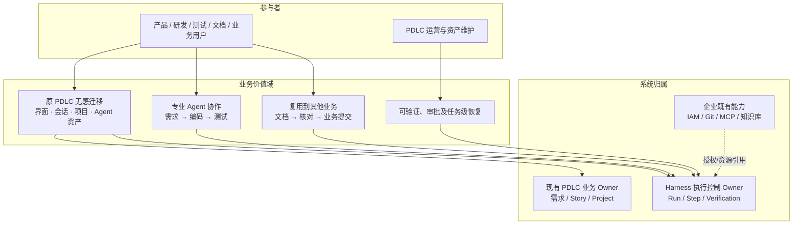

业务价值链为：接收意图 → 保留原产品能力 → 根据 Recipe 串联专业 Agent → 结构化成果交接 → Verification/Approval → 完成或安全恢复 → 回传可追溯 Evidence。迁移采用 M0–M4 灰度、单一 Writer 和回退门禁；**旧 PDLC 等价回归及新 Agent 串联业务 E2E 尚未验收**。

#### 3.1.2 逻辑架构（Logical Architecture）

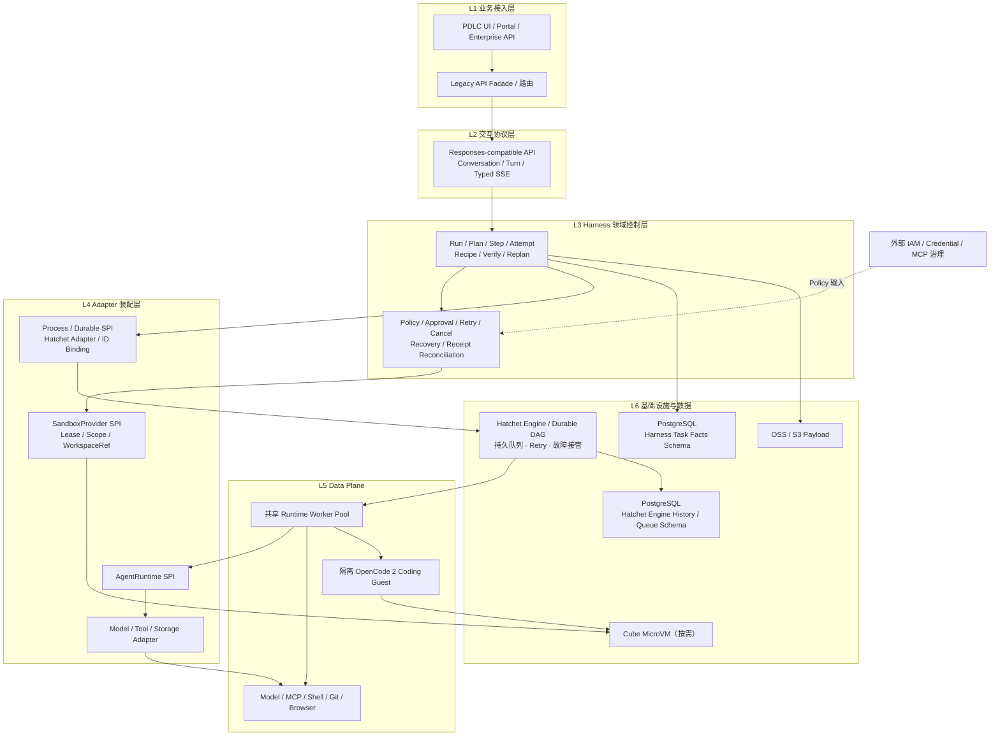

**不变式：** Session ≠ Run ≠ OS Process ≠ Workspace ≠ Sandbox；Runtime Session ID 与 Sandbox ID 是绑定引用而不是权限凭据。AgentRuntime SPI（如何运行 Agent）和 Process/Durable SPI（任务怎样耐久执行）分开；不重写 SDK 内核，不让 Cube 决定 Run 终态。Version/Capability Directory 是逻辑能力，不必建独立注册中心。

#### 3.1.3 应用架构（Application Architecture）

以下是模块/接口图，**不是强制的微服务拆分**。兼容入口和核心 API 可以合部署，Worker 可单独弹性扩容。

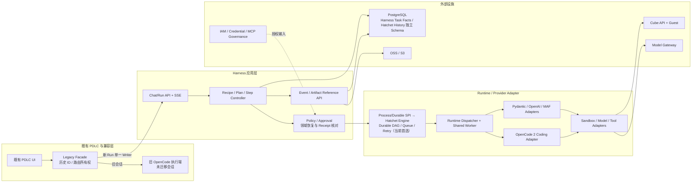

关键公开合同：旧 API 兼容、Responses-compatible + Harness Events、AgentRuntime SPI、Process/Durable SPI、SandboxProvider SPI、Model/Tool Adapter、Artifact/Evidence Reference。旧的 OpenCode Session 不自动等价于已发生的平台 Run，存量消息与执行事实必须分别迁移/核对。

#### 3.1.4 技术架构（Technology Architecture）

这里展示的是**可替换技术槽位**而不是要同时安装全部候选。Python 侧为平台优先，Java 原生不作首轮评分项。

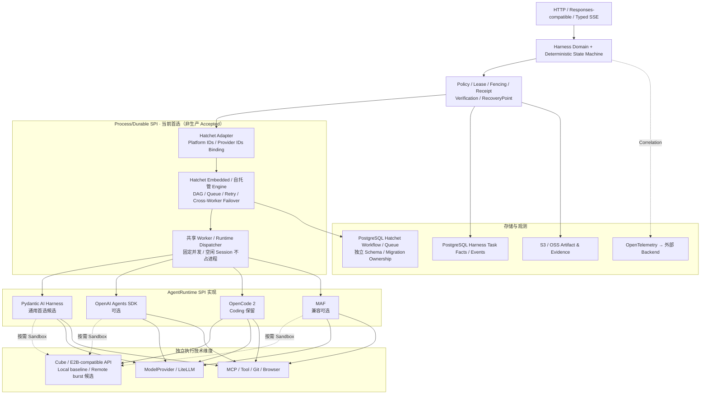

**已知证据与限制：** Hatchet v0.110.5（Python SDK 1.42.1）在真实 Engine、PostgreSQL、双 SDK DAG 与双 Engine 跨 Worker 安全步骤接管均获得**分项 LIVE PASS**，但不是同一 Run 全链 PASS。Cube v0.7.2 + E2B Python 2.40.0 在指定 DNS/TLS 条件下有真实功能 PASS；E2B 2.53.1 创建接口仍 405。平台任务级 Approval / SideEffectReceipt UNKNOWN、真实 Token SSE、可信 Lease/Cube 跨 Worker 重绑和容量仍 OPEN；**DBOS REJECTED，Hatchet 仅为当前实施首选，尚非生产 Accepted**。详见 [Hatchet 架构决议](docs/references/HATCHET_PROCESS_DURABLE_ARCHITECTURE_20261010.md)及[版本矩阵](docs/references/VERIFIED_STACK_BASELINE_20261010.md)。

#### 3.1.5 数据架构（Data Architecture）

平台拥有 Task Facts 与 Metadata，OSS/S3 承载大 Payload；**Hatchet Engine 使用独立 Workflow/Queue History Schema**，平台只存 Provider Workflow/Task ID Binding 与状态核对事实；旧 PDLC 业务数据、Git Revision 和 SDK 原生 Checkpoint 归各自 Owner。

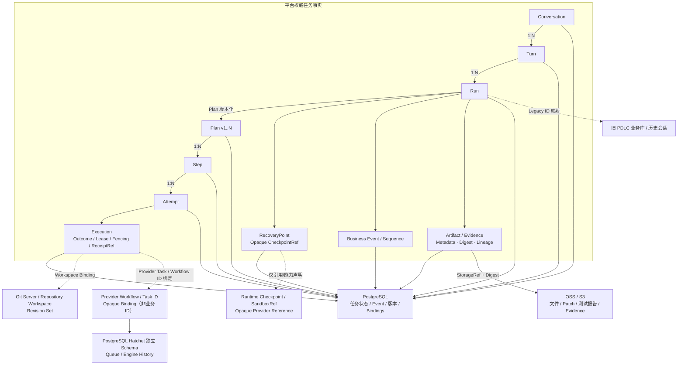

**交接数据合同：** Agent A 的结构化输出通过 Verification，附 ArtifactRef/Digest/Scope/版本信息后才交给 Agent B；不能将整段原生 Chat History 或 Sandbox ID 直接当成可复用可信授权。Run 创建冻结 Recipe/Runtime/Model/Tool/Policy/Environment 版本；UNKNOWN 必须查询 Receipt 或人工对账，不盲重试。业务 Event 是事实；Trace/Log/Metric 是诊断。Harness 只做任务恢复，不做数据库/存储备份和灾备。

#### 3.1.6 部署架构（Deployment Architecture）

私有化**候选拓扑**，不预设 K8s/容器具体节点数与 HA；Local Cube baseline + Remote Cube burst 是目标策略，后者尚未按生产门禁完成验证。

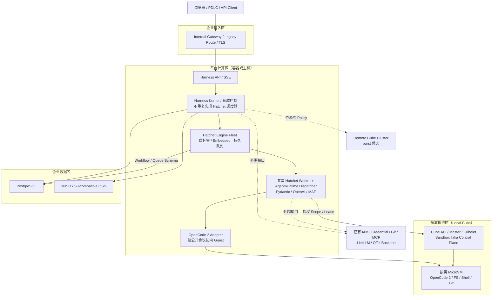

**节省资源和隔离：** 轻量 Agent 可以零 Sandbox；一个共享 Worker 服务多个逻辑 Session，不要求一个历史 Session 永久一个 Agent OS 进程或 Cube。需要 FS/Shell/Git 的 Coding 执行优先 Harness-in-Cube；同 Scope 的多个逻辑 Session 是否复用同 Sandbox 需显式授权，不能跨用户/项目/秘密边界共享。OpenCode 在共享 Host 的原生 Shell **不会**自动随 Session ID 转发到 Cube，这条替代拓扑不能当作生产隔离已通过。环境采用 immutable OCI digest 与版本对照，生产一致性、Burst、容量仍需单独 Gate。

#### 3.1.7 功能架构（Functional Architecture）

业务 Agent 按能力和 Recipe 装配，不为产品/研发/测试/文档/业务分别复制一套 Harness。

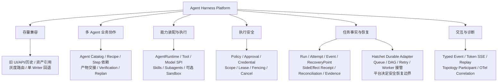

第一期 P0 必须独立通过：① 原 PDLC 真实功能、资产、历史、API、权限回归；② 一个 Run 内至少两个不同 Runtime 按 Recipe 交接 Artifact/Evidence，验证失败阻断下游、审批等待和任务级恢复安全。功能图**不**包含企业 IAM、MCP Marketplace、计费、镜像安全或运维监控产品的自建任务。

#### 3.1.8 运行架构（Runtime Architecture）

运行架构展示**动态时序和恢复决策**；[Runtime Topology Contract](docs/references/RUNTIME_TOPOLOGY.md) 只记录 Participant 身份/生命周期和 OWNS、SPAWNS、RUNS_ON、HANDOFF_TO 等稳定关系，不能取代 Plan/Workflow/Scheduler。

##### 3.1.8.1 正常执行：轻量 Agent → Coding → 测试 Agent

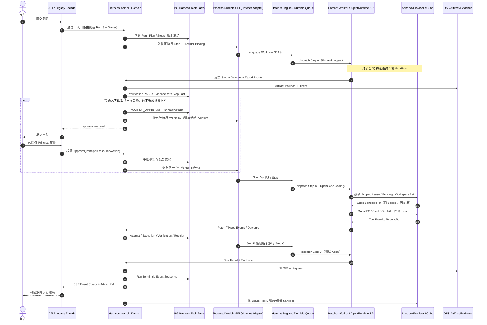

##### 3.1.8.2 故障路径：UNKNOWN 不能直接重试

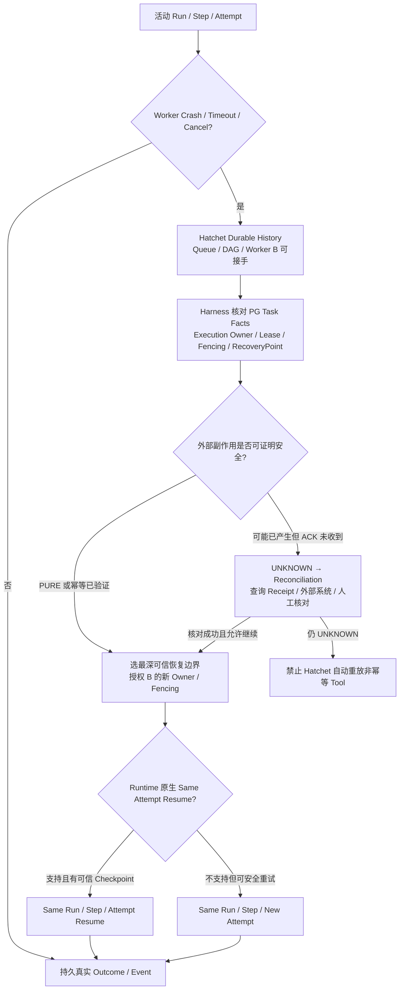

Runtime State、Workspace State、Sandbox State 彼此独立；**Hatchet 的引擎恢复和平台领域恢复分别由 Engine 与 Harness Domain 负责**，不能把两个 Owner 合并。平台只拥有任务级 RecoveryPoint 与 SDK 原生 checkpoint 的 Opaque Reference，不重写框架恢复引擎，不引入跨组件 2PC。Cancel Request 不等于下游已终止。SSE 只能反映真实执行事件。此时序是**目标一体化链路**，现有多个局部 POC 不能拼成一个已经完成的 E2E 生产证据。

#### 3.1.9 跨视图一致性门禁

| 不变式 | 核心视图 | 当前状态 |
|---|---|---|
| 原 PDLC 无感兼容和跨 Agent 串联分别验收 | 业务/应用/功能 | 业务目标已确认，真实 E2E OPEN |
| Conversation → Turn → Run → Plan(vN) → Step → Attempt，Run 终态不重开 | 逻辑/数据/运行 | Accepted Contract |
| AgentRuntime、Process/Durable、SandboxProvider 三个 SPI 相互独立 | 逻辑/应用/技术 | Accepted 边界；Process/Durable 当前首选 Hatchet Adapter（未生产 Accepted） |
| Control Plane 才能最终裁决 Run 状态 | 逻辑/应用/运行 | Accepted Contract |
| 轻量 Agent 零 Sandbox；Coding 默认隔离 | 技术/部署/运行 | 局部 Cube/OpenCode 功能 POC PASS，生产隔离 OPEN |
| Session ID 非授权；Binding 要校验 Scope / Lease / Fencing | 数据/部署/运行 | Accepted 合同；Hatchet 跨 Engine 安全任务接管已 LIVE PASS，平台可信 Lease/Cube 接管仍 OPEN |
| PG 保存任务事实，OSS 保存大 Payload，Native Checkpoint 是 Opaque 引用 | 数据/部署 | Accepted Contract，全链集成 OPEN |
| UNKNOWN → Reconciliation；禁止非幂等盲重试 | 数据/功能/运行 | Accepted Contract，真实回执全链 OPEN |
| IAM / MCP 治理 / Secret / 观测后端 / Backup 不由 Harness 自建 | 全视图 | 明确 Ownership Boundary |
