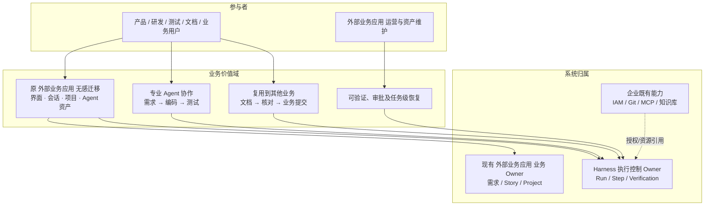
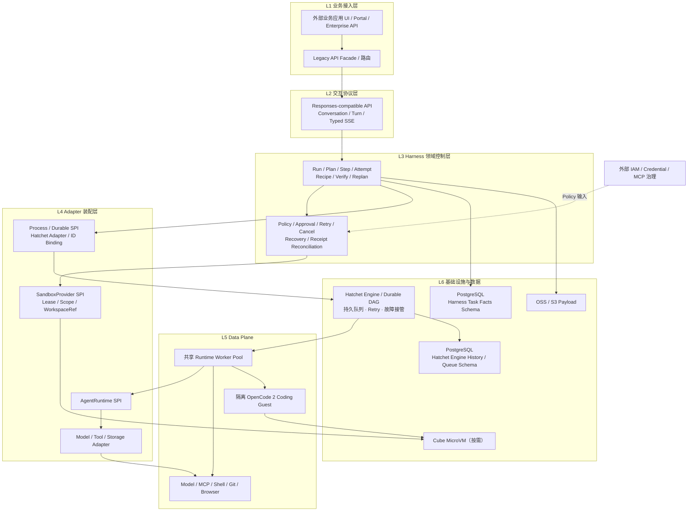
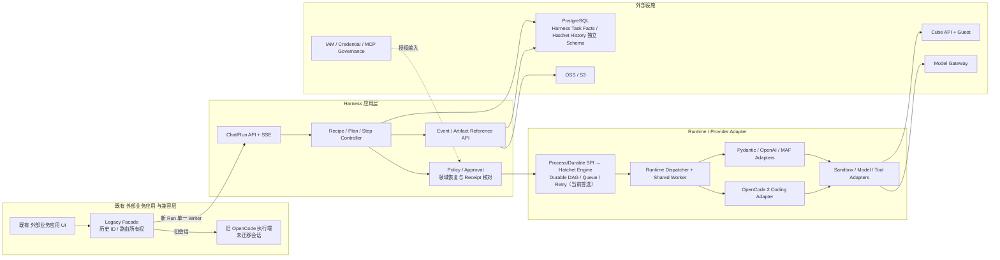
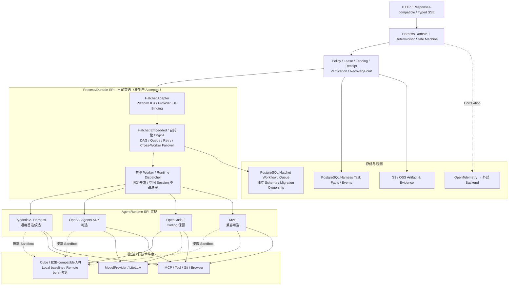
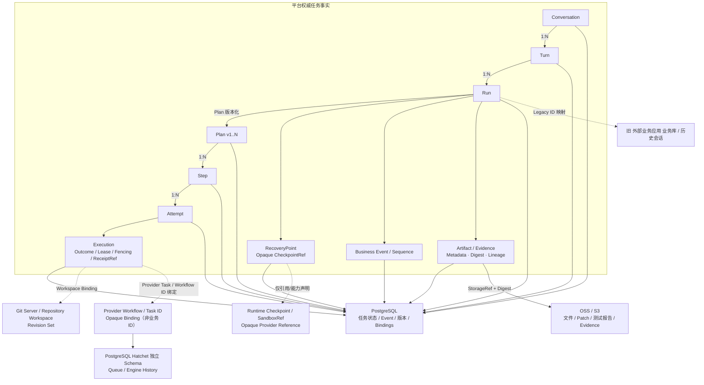
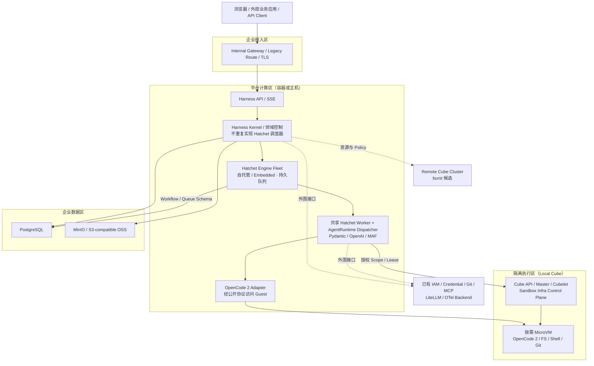
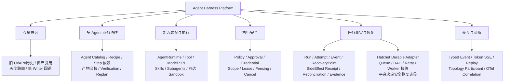
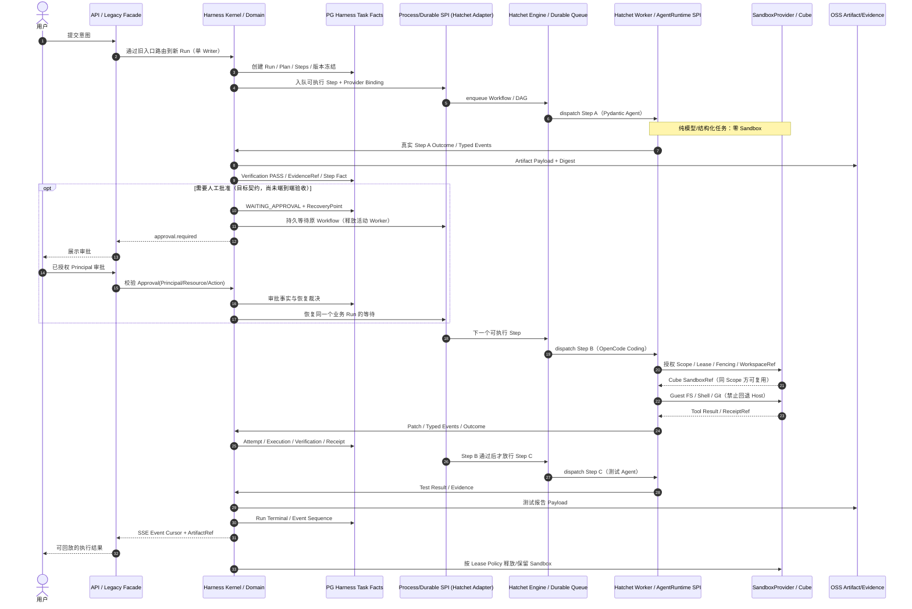
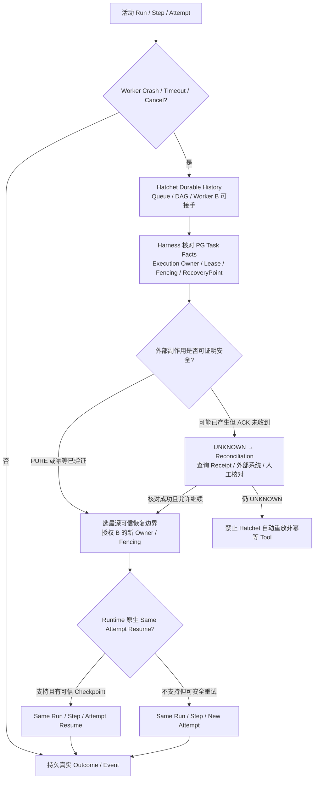

# 分层架构视图（Architecture Views）

> 此文件是业务、逻辑、应用、技术、数据、部署、功能和运行架构的唯一 Mermaid 图源。属于已冻结的架构视图，不代表所有图中能力均已投产。参见 [架构约束](ARCHITECTURE_GUARDRAILS.md)、[正式架构](ARCHITECTURE.md)及[里程碑状态](DEVELOPMENT_MILESTONES.md)。

### 3.1 八类分层架构视图

#### 八视图索引与六层逻辑模型

| 架构视图 | 回答的问题 | 明确不表达 |
|---|---|---|
| 业务架构 | 为什么建设、迁移什么、为谁提供价值 | 具体的部署拓扑 |
| 逻辑架构 | 分几层、每层权责、关键依赖与信任边界 | 必须部署六个服务 |
| 应用架构 | 应用模块与公开接口如何协作 | 所有模块已经实现 |
| 技术架构 | SDK/执行器/数据库的候选选择与替换槽位 | 技术候选已成为生产决策 |
| 数据架构 | 领域事实、Payload、外部数据的归属与流转 | 自建完整数据治理产品 |
| 部署架构 | 工作负载、资源、隔离、网络依赖如何布置 | HA/容量已经验收 |
| 功能架构 | 平台应交付的功能能力及 P0 边界 | 重建企业治理平台 |
| 运行架构 | 一次 Run 怎样运行、分配 Sandbox、恢复失败 | 运行拓扑取代业务流程 |

**统一的六层逻辑模型：** L1 业务接入 → L2 协议交互 → L3 Harness 领域控制 → L4 能力装配/Adapter → L5 Agent/Tool 执行 → L6 基础设施与持久化。L3 的 Control Plane 拥有 Run/Step 最终状态裁决；L5 Data Plane 负责真实执行。L6 的 Cube 资源控制面不等于 Harness 控制面。IAM、MCP Governance、Secret、Cost/Quota、观测后端与存储备份均为**外部系统**，不扩张 Harness 职责。

#### 3.1.1 业务架构（Business Architecture）

**两条相互独立的业务目标：** A. 取代现有以 OpenCode 为核心的 外部业务应用 平台执行架构，兼容现有用户体验、项目、会话、Agent/Skill/Prompt/MCP 等资产；B. 新增专业 Agent 可配置串联，先验收产品 → 研发 → 测试，再扩展文档/业务场景。当前存量专业 Agent 均使用 OpenCode，并非已经运行在多套 SDK 上。

业务价值链为：接收意图 → 保留原产品能力 → 根据 Recipe 串联专业 Agent → 结构化成果交接 → Verification/Approval → 完成或安全恢复 → 回传可追溯 Evidence。迁移采用 M0–M4 灰度、单一 Writer 和回退门禁；**旧 外部业务应用 等价回归及新 Agent 串联业务 E2E 尚未验收**。

#### 3.1.2 逻辑架构（Logical Architecture）

**不变式：** Session ≠ Run ≠ OS Process ≠ Workspace ≠ Sandbox；Runtime Session ID 与 Sandbox ID 是绑定引用而不是权限凭据。AgentRuntime SPI（如何运行 Agent）和 Process/Durable SPI（任务怎样耐久执行）分开；不重写 SDK 内核，不让 Cube 决定 Run 终态。Version/Capability Directory 是逻辑能力，不必建独立注册中心。

#### 3.1.3 应用架构（Application Architecture）

以下是模块/接口图，**不是强制的微服务拆分**。兼容入口和核心 API 可以合部署，Worker 可单独弹性扩容。

关键公开合同：旧 API 兼容、Responses-compatible + Harness Events、AgentRuntime SPI、Process/Durable SPI、SandboxProvider SPI、Model/Tool Adapter、Artifact/Evidence Reference。旧的 OpenCode Session 不自动等价于已发生的平台 Run，存量消息与执行事实必须分别迁移/核对。

#### 3.1.4 技术架构（Technology Architecture）

这里展示的是**可替换技术槽位**而不是要同时安装全部候选。Python 侧为平台优先，Java 原生不作首轮评分项。

**已知证据与限制：** Hatchet v0.110.5（Python SDK 1.42.1）在真实 Engine、PostgreSQL、双 SDK DAG 与双 Engine 跨 Worker 安全步骤接管均获得**分项 LIVE PASS**，但不是同一 Run 全链 PASS。Cube v0.7.2 + E2B Python 2.40.0 在指定 DNS/TLS 条件下有真实功能 PASS；E2B 2.53.1 创建接口仍 405。平台任务级 Approval / SideEffectReceipt UNKNOWN、真实 Token SSE、可信 Lease/Cube 跨 Worker 重绑和容量仍 OPEN；**DBOS REJECTED，Hatchet 仅为当前实施首选，尚非生产 Accepted**。详见 [Hatchet 架构决议](docs/references/HATCHET_PROCESS_DURABLE_ARCHITECTURE_20261010.md)及[版本矩阵](docs/references/VERIFIED_STACK_BASELINE_20261010.md)。

#### 3.1.5 数据架构（Data Architecture）

平台拥有 Task Facts 与 Metadata，OSS/S3 承载大 Payload；**Hatchet Engine 使用独立 Workflow/Queue History Schema**，平台只存 Provider Workflow/Task ID Binding 与状态核对事实；旧 外部业务应用 业务数据、Git Revision 和 SDK 原生 Checkpoint 归各自 Owner。

**交接数据合同：** Agent A 的结构化输出通过 Verification，附 ArtifactRef/Digest/Scope/版本信息后才交给 Agent B；不能将整段原生 Chat History 或 Sandbox ID 直接当成可复用可信授权。Run 创建冻结 Recipe/Runtime/Model/Tool/Policy/Environment 版本；UNKNOWN 必须查询 Receipt 或人工对账，不盲重试。业务 Event 是事实；Trace/Log/Metric 是诊断。Harness 只做任务恢复，不做数据库/存储备份和灾备。

#### 3.1.6 部署架构（Deployment Architecture）

私有化**候选拓扑**，不预设 K8s/容器具体节点数与 HA；Local Cube baseline + Remote Cube burst 是目标策略，后者尚未按生产门禁完成验证。

**节省资源和隔离：** 轻量 Agent 可以零 Sandbox；一个共享 Worker 服务多个逻辑 Session，不要求一个历史 Session 永久一个 Agent OS 进程或 Cube。需要 FS/Shell/Git 的 Coding 执行优先 Harness-in-Cube；同 Scope 的多个逻辑 Session 是否复用同 Sandbox 需显式授权，不能跨用户/项目/秘密边界共享。OpenCode 在共享 Host 的原生 Shell **不会**自动随 Session ID 转发到 Cube，这条替代拓扑不能当作生产隔离已通过。环境采用 immutable OCI digest 与版本对照，生产一致性、Burst、容量仍需单独 Gate。

#### 3.1.7 功能架构（Functional Architecture）

业务 Agent 按能力和 Recipe 装配，不为产品/研发/测试/文档/业务分别复制一套 Harness。

第一期 P0 必须独立通过：① 原 外部业务应用 真实功能、资产、历史、API、权限回归；② 一个 Run 内至少两个不同 Runtime 按 Recipe 交接 Artifact/Evidence，验证失败阻断下游、审批等待和任务级恢复安全。功能图**不**包含企业 IAM、MCP Marketplace、计费、镜像安全或运维监控产品的自建任务。

#### 3.1.8 运行架构（Runtime Architecture）

运行架构展示**动态时序和恢复决策**；[Runtime Topology Contract](docs/references/RUNTIME_TOPOLOGY.md) 只记录 Participant 身份/生命周期和 OWNS、SPAWNS、RUNS_ON、HANDOFF_TO 等稳定关系，不能取代 Plan/Workflow/Scheduler。

##### 3.1.8.1 正常执行：轻量 Agent → Coding → 测试 Agent

##### 3.1.8.2 故障路径：UNKNOWN 不能直接重试

Runtime State、Workspace State、Sandbox State 彼此独立；**Hatchet 的引擎恢复和平台领域恢复分别由 Engine 与 Harness Domain 负责**，不能把两个 Owner 合并。平台只拥有任务级 RecoveryPoint 与 SDK 原生 checkpoint 的 Opaque Reference，不重写框架恢复引擎，不引入跨组件 2PC。Cancel Request 不等于下游已终止。SSE 只能反映真实执行事件。此时序是**目标一体化链路**，现有多个局部 POC 不能拼成一个已经完成的 E2E 生产证据。

#### 3.1.9 跨视图一致性门禁

| 不变式 | 核心视图 | 当前状态 |
|---|---|---|
| 原 外部业务应用 无感兼容和跨 Agent 串联分别验收 | 业务/应用/功能 | 业务目标已确认，真实 E2E OPEN |
| Conversation → Turn → Run → Plan(vN) → Step → Attempt，Run 终态不重开 | 逻辑/数据/运行 | Accepted Contract |
| AgentRuntime、Process/Durable、SandboxProvider 三个 SPI 相互独立 | 逻辑/应用/技术 | Accepted 边界；Process/Durable 当前首选 Hatchet Adapter（未生产 Accepted） |
| Control Plane 才能最终裁决 Run 状态 | 逻辑/应用/运行 | Accepted Contract |
| 轻量 Agent 零 Sandbox；Coding 默认隔离 | 技术/部署/运行 | 局部 Cube/OpenCode 功能 POC PASS，生产隔离 OPEN |
| Session ID 非授权；Binding 要校验 Scope / Lease / Fencing | 数据/部署/运行 | Accepted 合同；Hatchet 跨 Engine 安全任务接管已 LIVE PASS，平台可信 Lease/Cube 接管仍 OPEN |
| PG 保存任务事实，OSS 保存大 Payload，Native Checkpoint 是 Opaque 引用 | 数据/部署 | Accepted Contract，全链集成 OPEN |
| UNKNOWN → Reconciliation；禁止非幂等盲重试 | 数据/功能/运行 | Accepted Contract，真实回执全链 OPEN |
| IAM / MCP 治理 / Secret / 观测后端 / Backup 不由 Harness 自建 | 全视图 | 明确 Ownership Boundary |

**维护原则：** 新的局部验证结果先更新专项 Findings、Admission、Architecture Backlog；修改 Accepted Contract 须走 ADR，不能仅通过修改本视图产生新决策。