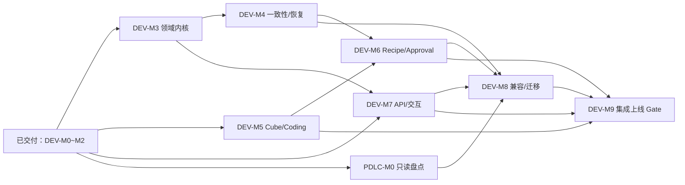

# Agent Harness Platform · 正式研发里程碑计划

| 文档属性 | 内容 |
|---|---|
| 编号 | AHP-DEV-ROADMAP-001 |
| 版本 | v1.0 · 2026-10-11 |
| 阶段 | **正式开发实施（Implementation）**，不是架构选型/POC 阶段 |
| 计划范围 | DEV-M0～DEV-M9；平台研发、沙箱、安全可靠性、PDLC 迁移、生产交付 |
| 规划原则 | Accepted ADR / G01–G20 / HC-01～03 优先；Red→Green→Refactor→真实验收→复盘；技术局部 PASS 不等于生产准入 |
| 权威参考 | [Development Backlog](DEVELOPMENT_BACKLOG.md) · [HC-01](references/HATCHET_WORKFLOW_MAPPING_CONTRACT_20261010.md) · [HC-02](references/HARNESS_HATCHET_CONSISTENCY_CONTRACT_20261010.md) · [HC-03](references/HATCHET_WORKER_SANDBOX_BINDING_CONTRACT_20261010.md) · [PDLC 迁移](references/PDLC_REPLACEMENT_MIGRATION_20261010.md) |

## 1. 目标、成果与范围

**第一期产品成功 = 存量 PDLC 用户体验/功能/数据不退化 + 新平台真实专业 Agent 串联可用 + 安全可恢复且可回退。** 这是三个独立验收维度，不以技术 Demo 替代。平台仅拥有薄 Harness Domain Control Plane（Run/Plan/Step/Attempt、业务验证、审批、Receipt、状态投影、领域终态），Hatchet 继续拥有 Workflow/Task/DAG/Queue/Worker/Retry 等技术执行状态。Session ≠ Run ≠ Worker Process ≠ Workspace ≠ Sandbox。

既有成果已经进入**开发代码及验证**：PostgreSQL 双库、真实 Hatchet DAG、Pydantic AI / OpenAI Agents SDK、LiteLLM Responses、结构化交接、Run Inspector、真实模型 Token 文本 SSE/持久事件/游标重放/模型级取消，已合并 Main 并有独立真实验证与 CI 证据。其验收口径为“该开发切片验收通过”，**不是全平台生产 Ready**。早期 `docs/POC.md` 作为历史验证档案保留，不再代表当前项目阶段。

## 2. 里程碑状态（2026-10-11 基线）

| 项目里程碑 | 可向业务/团队交付的能力 | 前置 / 追踪任务 | 基线状态 | 阶段退出 Gate |
|---|---|---|---|---|
| **DEV-M0 架构基线** | 统一业务/技术/数据/运行架构，ADR-031/032、G01–G20、HC-01/02/03 | ARCH-TODO-001～030 | **已完成架构决策** | 合同 Decision/ADR 纳入仓库；注意合同冻结 ≠ 功能验收 |
| **DEV-M1 基础可运行平台** | Docker PG16 双 DB + 真实 Hatchet DAG + 双 SDK + Run Inspector + 持久业务 Run | [归档最小闭环](../openspec/changes/archive/) | **开发切片已完成** | 真 Engine/PG/Run/Step/终态 + CI PASS；完整 Kernel 仍归 M3/4 |
| **DEV-M2 真实模型与交互** | LiteLLM Responses、需求分析/审核、Token SSE、游标回放、模型级取消、结果可解释 | [M1 已归档业务模型变更](../openspec/changes/archive/2026-10-11-real-model-agent-closed-loop/) | **开发切片已完成** | 双真实模型 SDK、PG 519 事件回放、取消、CI PASS；模型-only 范围，不含审批/Cube/Receipt |
| **DEV-M3 领域内核完善** | Plan/Step/Attempt 版本、Replan、Workflow Segment、Provider Binding、合法终态投影 | DEV-HC-01 / HC-01 | **ACTIVE：Plan v1 冻结与 Replan Intent 已通过真实 PG 测试，安全切换 Gate OPEN** | 单 Run 真 Replan、新 Segment、旧 Attempt 拒绝、无第二调度器 |
| **DEV-M4 持久可靠性** | Transactional Outbox/Inbox、ACK-loss reconcile、UNKNOWN / 非幂等 Tool Receipt、任务级恢复 | DEV-HC-02 / HC-02 | **部分实现，真实故障 Gate 未完成** | SIGKILL、并发重复投递、ACK 丢失、Receipt 对账，不盲目重试 |
| **DEV-M5 Cube 可信执行** | SandboxProvider/WorkspaceRef/Session Scope、Lease/Fencing、跨 Worker 重连、OpenCode Coding Guest | DEV-HC-03 / HC-03 | **ACTIVE：可信 Execution Gate 负例已通过；真实 Cube A→B Gate OPEN** | Worker A→B 同受控 Workspace、旧 Owner/跨 Scope 拒绝、model-only 无沙箱 |
| **DEV-M6 可配置 Agent 工作流** | Recipe A→B→C、异构 SDK、Artifact/Evidence、Verifier、Approval/任务级恢复 | DEV-HC-01～03 / DEV-PDLC-04 | **待开发** | 真正产品→Coding→测试、审批/失败/恢复与可回溯交接 |
| **DEV-M7 产品/API 接入** | Conversation/Turn/Run/Typed SSE、文件/Artifact 引用、Agent 选型、业务可读交互与外部授权输入 | M2/M3；PDLC-M1 前置 | **Inspector 有交付，其余待开发** | 统一 API/身份鉴权/历史/跨 Scope 拒绝；不重新做企业 IAM |
| **DEV-M8 PDLC 迁移** | 存量只读盘点→兼容 Facade→影子/灰度→真实 Recipe→分批切流及回退 | DEV-PDLC-01～05，详见 §5 | **ACTIVE：PDLC-M0 私有源码只读基线完成第一版，现网与资产核验仍 OPEN** | 旧入口/数据/资产/会话等价、单 Writer、实际 PDLC E2E 与回退 |
| **DEV-M9 集成与上线** | 私有部署、性能/容量/恢复/权限/监控、100 Active Runs 实测、上线/回退手册 | M3～M8 与外部 Owner | **待开发** | PDLC 不退化 + Recipe 可用 + 生产隔离/可靠性/容量全 Gate PASS 后才 GO |

**命名约定**：项目统一用 `DEV-M0…DEV-M9`；`PDLC-M0…PDLC-M4` 只代表 **DEV-M8 内部迁移阶段**；历史 OpenSpec 的 `M1` 是已归档的“真实模型变更名”，不再用来代表整个正式项目。保留 `DEV-HC-01～03`、`DEV-PDLC-01～05` 原始追踪 ID，不重复制造一套任务权威。

## 3. 实施路径、依赖与并行策略

**第一波（立即可启动）**：DEV-M3（领域/Segment）、DEV-M5（Cube 可信绑定）、PDLC-M0（存量只读盘点）三条线并行；DEV-M4 的负例/事务设计可与 M3 并行，但最终并发/ACK/Receipt 集成以 M3 业务事实合同为前置。**第二波**：DEV-M4 集成、DEV-M7 统一入口并行推进；DEV-M6 以 M3/M4/M5 最小可用 Gate 为约束，选现网 PDLC 一条真实 Recipe。**第三波**：DEV-M8 的兼容 Facade/影子/灰度及 DEV-M9 系统 Gate 随模块成熟滚动验收，不安排未经核实的“全量切换日”。

**计划周期与人员**：当前仅承诺**先后依赖及 Gate**，不虚构具体交付日期、团队人数、点数或预计工时。每个阶段启动前由负责人与产品/测试确认实际容量、代表性用例、Sprint 边界、风险/回退，形成有依据的迭代排期。若须固定目标日期，先依据真实代码量与 PDLC-M0 现网盘点做估算后再基线化。

## 4. OpenSpec 统一规划和分阶段实施

| 阶段 | 独立 OpenSpec（均须 Proposal / Specs / Design / Tasks） | 工作方式 |
|---|---|---|
| DEV-M3 | [dev-m3-run-plan-domain](../openspec/changes/dev-m3-run-plan-domain/) | 优先启动，按 HC-01 分规格/实现/负例/真实 Replan |
| DEV-M4 | [dev-m4-reliable-task-facts](../openspec/changes/dev-m4-reliable-task-facts/) | 与 M3 联动的真实一致性/Receipt 故障验收 |
| DEV-M5 | [dev-m5-sandbox-worker-binding](../openspec/changes/dev-m5-sandbox-worker-binding/) | 独立 Cube 真机验证→同 Run 集成 |
| DEV-M6 | [dev-m6-agent-recipe-execution](../openspec/changes/dev-m6-agent-recipe-execution/) | 真实 A→B→C 和 Approval/Verification |
| DEV-M7 | [dev-m7-platform-access-contract](../openspec/changes/dev-m7-platform-access-contract/) | 用户 API/稳定协议/跨 Scope 访问拒绝 |
| DEV-M8 | [dev-m8-legacy-pdlc-transition](../openspec/changes/dev-m8-legacy-pdlc-transition/) | DEV-PDLC-01～05 的内部 M0～M4 阶段 Gate |
| DEV-M9 | [dev-m9-delivery-readiness](../openspec/changes/dev-m9-delivery-readiness/) | 生产环境与上线 GO/NO-GO |

**OpenSpec 建档并非开发完成**：新阶段的 4/4 表示规划文件齐全，Tasks 全部保持未勾选。开始实施时以阶段 Change 为需求合同，建议每个可独立上线的代码切片再按该阶段的已验证 Delta 建子 Change/PR；避免一个长期 PR 把多个领域、沙箱、PDLC 写侧的变更混在一起。每个 Sprint 应更新 Tasks / 设计 / 测试证据 / 阻断及下一步；完成门禁→合并→归档，未通过的留 OPEN。

## 5. DEV-M8 内部 PDLC-M0～M4 迁移计划

| 迁移阶段 | 对应任务 | 必要输入 | 可检验交付 / 退出 Gate |
|---|---|---|---|
| **PDLC-M0 只读现网基线** | DEV-PDLC-01 | 旧源码、部署版本、OpenAPI、DB/OSS、UI/SSO、OpenCode Session/Agent/Skill/MCP 资产 | Legacy Feature/API/Data/Session→New Owner/Adapter/Mapping→Test/Backout 矩阵；真实样本，清晰区分历史与活动会话 |
| **PDLC-M1 兼容外壳** | DEV-PDLC-02 | M0 基线，DEV-M7 访问合同 | 旧页面/URL/SSO/历史与项目、稳定 ID Mapping、授权等价回归 |
| **PDLC-M2 影子与单 Writer 灰度** | DEV-PDLC-03 | M1、HC-02 可靠性门禁 | 单权威写入、只读 Shadow、不重复 Tool/Git/审批，白名单可回退 |
| **PDLC-M3 真实新能力** | DEV-PDLC-04 | DEV-M3/4/5/6、M0 真实业务样本 | 产品→Coding→测试至少跨两 SDK，有 Artifact/Evidence、审批、失败/任务级恢复 |
| **PDLC-M4 迁移上线** | DEV-PDLC-05 | M1～M3 与 DEV-M9 部署安全门禁 | 按用户/项目灰度，历史/活动会话、审计/权限/数据核对及回退实测，确认 GO 才退休旧执行端 |

迁移不等于一次性替换 OpenCode：Coding Runtime 可继续使用 OpenCode，旧会话可按安全策略留原服务执行。禁止双写、禁止凭历史 Session 自行制造新 Run 的执行记录、禁止未经核对的副作用重放。

## 6. 每阶段强制准入和收口清单

1. **Architecture Gate**：先读 `AGENTS.md`、G01–G20、ADR、HC-01～03；标注变化的 Owner、状态写入边界、失败窗口与 Accepted Contract 是否变更。违反已冻结架构须先独立 ADR。
2. **TDD Gate**：先写可失败的成功/失败/越权/UNKNOWN/乱序/取消测试并记录 Red；最小代码转 Green；重构后完整回归。不允许仅 UI 动画/模拟 SDK 响应宣称真实功能。
3. **Integration Gate**：使用该阶段所要求的真实 PostgreSQL、Hatchet、LiteLLM、Cube、Tool/Shell/Git 或旧 PDLC 实际样本；附 Run、Workflow、Event、Receipt、Workspace/Lease 等能核查的证据。SKIPPED/NOT_TESTED 不算 PASS。
4. **Security/Recovery Gate**：最小权限、跨 Scope 拒绝、旧 Fencing 失效、UNKNOWN Fail Closed、终态不可重开、Worker 中断可恢复、Tool 外部副作用不能二次执行（依阶段适用）。
5. **User Outcome Gate**：交付界面讲得清“为什么执行、每节点干了什么、输入输出和最后结果”，满足用户/API 体验；不默认只展示 JSON。
6. **CI/Review/Retrospective Gate**：提交 PR/CI、架构护栏/链接/Strict OpenSpec 校验，完成根因与改进复盘；全部证据后更新 Tasks，合并并归档。
7. **Production GO Gate（只有 DEV-M9）**：PDLC 等价 + 真实新业务串联 + 生产隔离/安全/容量/回滚三者均 PASS。任一不通过保持 NO-GO；旧平台继续受控服务。

## 7. 状态治理与变更控制

- `PLANNED`：Proposal/Specs/Design/Tasks 建档 4/4、无代码声明；`ACTIVE`：已开工，有 Red/Green 和 PR 证据；`BLOCKED`：记录外部条件与 Owner；`ACCEPTED-DEV`：该里程碑全部退出门禁通过且归档；`PRODUCTION-ACCEPTED` 只可由 DEV-M9 的 GO 判定赋予；`DEFERRED`：明确非当前第一期。
- 计划本身只确认依赖和验收口径；任务完成程度及每条正/负例由各 OpenSpec 和 CI/Live 证据共同确定，不能从规划 4/4 推断开发进度。
- 变更优先级：Accepted ADR/HC > 本计划 > 单个 Change 实施拆分；如计划与原冻结合同冲突，先修正规划，不偷偷更改约束。每次更改里程碑目标/门禁，需变更 PR、影响评审并更新依赖图。
- 过程记录：`docs/DEVELOPMENT_BACKLOG.md` 维护原 DEV-HC/DEV-PDLC IDs；本文件维护项目级 Milestones；OpenSpec 维护需求/技术设计/验收任务；CI/Live 日志维护事实证据。不存在第二份相互冲突的开发任务权威。